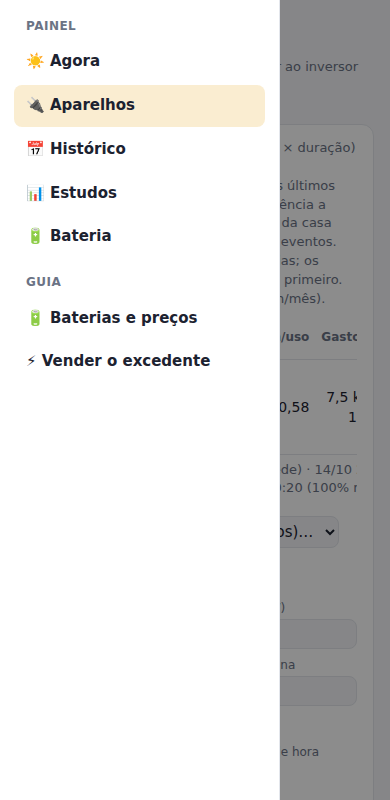
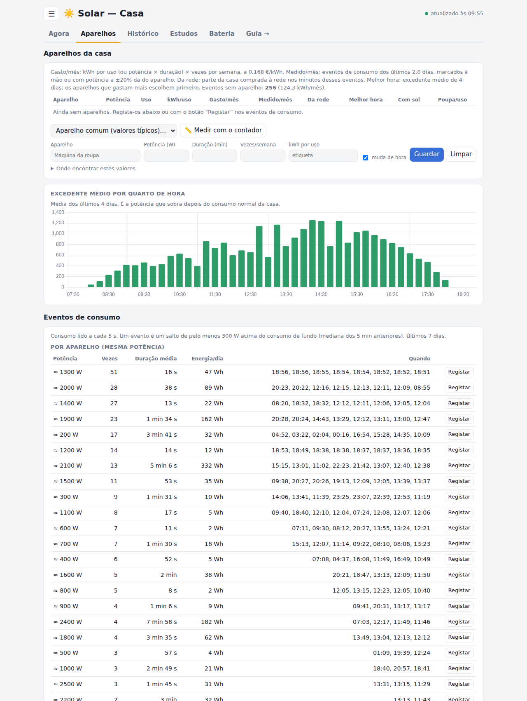

# ☀️ Growatt — painel solar local

Painel web simples para acompanhar um inversor **Growatt MIN 4200TL-XH** (instalação de 4,0 kWp: 8 painéis JA Solar JAM66S30-500/MR em 2 linhas de 4, contador Growatt SPM-E). Mostra a produção, o consumo da casa e as trocas com a rede.

O programa lê o inversor diretamente por **Modbus TCP**, através do dongle Wi-Fi, e **apenas lê**: nunca escreve nada no inversor. Não usa a cloud da Growatt e não precisa de dependências externas, só da biblioteca padrão do Python 3. Corre num Raspberry Pi como serviço `systemd` de utilizador.

<p align="center">
  
</p>

<p align="center">
  
  &nbsp;
  
</p>

## Como usar

A página está dividida em separadores. No computador aparecem numa barra por baixo do título; no telemóvel, e em qualquer ecrã, o botão **☰** abre o menu com todos eles e com as secções do guia. O endereço guarda o separador aberto (por exemplo `http://<ip>:8096/#aparelhos`), por isso cada um pode ficar nos favoritos ou no ecrã principal do telemóvel.

<p align="center">
  
</p>

| Separador | O que tem |
|---|---|
| **Agora** | A melhor altura para gastar (e um aviso quando há excedente a sair), a potência dos painéis, da casa, da compra e do envio, a energia de hoje e o gráfico do dia |
| **Aparelhos** | Os aparelhos da casa, quanto gasta cada um, a melhor hora para os ligar, o excedente por quarto de hora e os eventos de consumo |
| **Histórico** | Os últimos 30 dias, as linhas de painéis, os totais desde a instalação e o estado do inversor |
| **Estudos** | A potência contratada e a escolha entre tarifa simples e bi-horária |
| **Bateria** | Quanto teriam poupado as baterias no inversor e as de tomada |
| **Guia** (`/guia`) | Preços e compatibilidade das baterias e os passos para vender o excedente |

### Registar os aparelhos

<p align="center">
  
</p>

Para cada aparelho são precisos a potência (W), a duração de um uso (min) e as vezes por semana. Quem não souber os valores tem três formas de os obter:

1. **Aparelho comum (valores típicos):** escolher na lista (máquina de lavar roupa, máquina de lavar loiça, forno, placa de indução, frigorífico, chaleira, carro elétrico) preenche tudo com valores típicos (fontes: Repsol e DECO Proteste). Depois é só ajustar as vezes por semana.
2. **📏 Medir com o contador:** com o aparelho desligado, carregar no botão (mede o consumo de fundo durante cerca de 20 s); ligar o aparelho e carregar em **Já liguei** (mede cerca de 30 s). A diferença fica na potência. Usa a leitura de 5 s do inversor; durante a medição não convém ligar ou desligar outras coisas.
3. **Etiqueta energética:** o campo **kWh por uso** aceita o valor da etiqueta. Máquinas de lavar roupa e loiça: "kWh/100 ciclos" ÷ 100. Frigorífico: "kWh/ano" ÷ 365, com 1440 min e 7 vezes por semana. A potência está na chapa de características (atrás do aparelho ou na porta).

Na tabela aparecem:

- **Gasto/mês:** kWh por uso (ou potência × duração) × vezes por semana, ao preço do kWh.
- **Medido/mês e Da rede:** a energia dos eventos de consumo desse aparelho e a parte que foi comprada à rede nesses minutos. Um evento conta para o aparelho se a potência estiver a ±20% da dele, ou se tiver sido marcado à mão na lista **Últimos eventos**. Como vários aparelhos têm potências parecidas (chaleira, forno, resistência da máquina), marcar os eventos à mão torna este número fiável.
- **Melhor hora, Com sol e Poupa/uso:** a janela em que o excedente médio dos últimos 14 dias cobre a maior parte do aparelho. Os aparelhos que gastam mais escolhem primeiro e ocupam esse excedente, para não ficarem todos à mesma hora. Os aparelhos sem "muda de hora" (frigorífico, placa) não têm melhor hora.

Nos **Eventos de consumo**, o botão **Registar** de cada grupo preenche o formulário com a potência e a duração medidas.

## O que mostra

- **Agora:** a potência dos painéis, o consumo da casa, quanto se compra à rede e quanto se envia para ela.
- **Hoje:** a energia produzida, gasta, comprada (com o custo em €) e enviada. Inclui um gráfico de para onde foi a energia dos painéis e outro da potência ao longo do dia.
- **Últimos 30 dias:** os totais de cada dia.
- **Linhas de painéis (strings):** para cada linha, a tensão, a corrente e a potência atuais, os kWh de hoje, o pico do dia (W e hora) e os kWh desde a instalação, com a percentagem de cada uma.
- **Desde a instalação:** os contadores totais do inversor.
- **Inversor:** o estado, a temperatura, a tensão e a frequência da rede.
- **Dica:** a janela de horas com mais excedente, calculada a partir das leituras reais dos últimos 7 dias. Serve para saber quando ligar as máquinas.
- **Bateria:** uma simulação, minuto a minuto, de quanto teriam poupado as baterias Growatt de 5 e 10 kWh (ligadas ao inversor) e duas baterias de tomada (Zendure SolarFlow 2400 AC+ e Marstek Venus E 3.0, a devolver até 800 W), com o retorno em anos.
- **Aparelhos:** o gasto de cada aparelho registado, o medido pelos eventos de consumo, a parte comprada à rede e a melhor hora para o ligar. Ver [Registar os aparelhos](#registar-os-aparelhos).
- **Estudos automáticos:** a **potência contratada** compara os picos de compra à rede (lidos a cada 5 s) com o limite de cada potência e indica a menor com 15% de folga. **Simples ou bi-horária** calcula o custo anual de cada opção com a energia comprada em cada minuto (ciclos diário e semanal).
- **Eventos de consumo:** o consumo é lido a cada 5 s. Cada salto de 300 W ou mais acima do consumo de fundo fica registado com a hora, a duração, a potência e a energia. Os eventos com a mesma potência são agrupados, porque correspondem normalmente ao mesmo aparelho.

### Guia: bateria e venda à rede (`/guia`)

A página `/guia` reúne:

- a análise de **bateria** com as leituras reais, as baterias compatíveis com o MIN 4200TL-XH (Growatt APX e ARK XH) e os preços, com as fontes;
- o passo a passo para **vender o excedente** em Portugal: registo da UPAC na DGEG, CPE de produção na E-Redes, atividade nas Finanças (CAE 35123), comparação de comercializadores e documentos para o contrato.

<p align="center">
  
</p>

## Como funciona

```
Inversor Growatt ──Modbus TCP :502──▶ solar.py ──▶ solar.db (SQLite)
   (dongle Wi-Fi)    a cada 60 s          │
                                          └──HTTP :8096──▶ index.html (Chart.js)
```

- O `solar.py` lê os *input registers* 3000–3099 (função 04) a cada minuto e guarda cada leitura em `solar.db`. Se uma leitura falhar, tenta mais duas vezes, porque o Wi-Fi do dongle é fraco.
- À noite o inversor desliga-se. Nesse período a página mostra a última leitura guardada.
- A página `index.html` é servida pelo próprio `solar.py` e vai buscar os dados à API.

### API

| Endpoint | Devolve |
|---|---|
| `GET /api/now` | A última leitura, os totais de hoje (incluindo por linha), os picos de cada linha e os preços do kWh |
| `GET /api/today?day=AAAA-MM-DD` | A curva de potência do dia (painéis, casa, compra, envio) |
| `GET /api/days?n=30` | Os totais diários de kWh dos últimos *n* dias (máximo 400) |
| `GET /api/tip` | A melhor janela de horas para gastar o excedente |
| `GET /api/power?days=30` | Os picos de compra à rede contra as potências contratadas |
| `GET /api/tariff?days=30` | Simples ou bi-horária: % em vazio e custo anual de cada opção |
| `GET /api/events?days=7` | Os eventos de consumo e os grupos por potência |
| `GET /api/battery?days=30` | A simulação de baterias (Growatt no inversor e baterias de tomada) com as leituras reais |
| `GET /api/appliances?days=14` | Os aparelhos registados: gasto declarado e medido, parte comprada à rede e melhor hora |
| `POST /api/appliances` | Cria ou altera um aparelho (`{id?, name, watts, minutes, per_week, flexible}`) |
| `POST /api/appliances/delete` | Apaga um aparelho (`{id}`) |
| `POST /api/events/label` | Marca um evento de consumo como sendo de um aparelho (`{start, appliance_id}`) |

Os totais por dia calculam-se pela diferença dos contadores totais do inversor. Os contadores "hoje" do próprio inversor só voltam a zero quando ele acorda, por isso de madrugada ainda mostrariam o dia anterior.

## Instalação

Guia completo, passo a passo, para instalar numa máquina Linux sempre ligada (um Raspberry Pi, por exemplo) que esteja na mesma rede que o inversor.

### 1. Requisitos

- Linux com `systemd`. Foi testado em Ubuntu no Raspberry Pi.
- Python 3.8 ou mais recente e `git`.
- Um inversor Growatt com **Modbus TCP acessível na rede local** (porta 502), normalmente através do dongle Wi-Fi ou LAN.

Para instalar o Python e o `git` (Debian, Ubuntu ou Raspberry Pi OS):

```bash
sudo apt update
sudo apt install -y python3 git
```

Não há mais nada para instalar: o programa só usa a biblioteca padrão do Python.

### 2. Descobrir o IP do inversor

Procure o dongle na lista de dispositivos do router. Convém **reservar-lhe um IP fixo** no router (pelo MAC do dongle), para o endereço não mudar.

Confirme que a porta Modbus responde. Troque `192.168.1.69` pelo IP do seu dongle:

```bash
nc -zv 192.168.1.69 502
# ou, sem nc:
timeout 3 bash -c '</dev/tcp/192.168.1.69/502' && echo "porta 502 aberta"
```

> O inversor desliga-se à noite. Faça este teste de dia, com sol.

### 3. Descarregar o projeto

O ficheiro do serviço espera o projeto em `~/growatt`, por isso clone-o para essa pasta:

```bash
git clone https://github.com/brumarx/growatt.git ~/growatt
cd ~/growatt
```

### 4. Testar à mão

```bash
SOLAR_INVERTER_IP=192.168.1.69 python3 solar.py
```

Abra `http://<ip-da-máquina>:8096` no browser. Ao fim de cerca de um minuto aparecem os primeiros valores. Para parar, carregue em `Ctrl+C`. O `solar.db` é criado automaticamente na primeira execução.

> Para saber o IP da máquina, use `hostname -I`.

### 5. Configurar

Se o IP do inversor não for `192.168.1.69`, ou se quiser outro preço do kWh, edite o `solar.service` e acrescente linhas `Environment=` na secção `[Service]`. As opções estão descritas em [Configuração](#configuração):

```ini
[Service]
Environment=SOLAR_INVERTER_IP=192.168.1.50
Environment=SOLAR_PRICE_KWH=0.20
```

### 6. Instalar como serviço (arranque automático)

```bash
systemctl --user link ~/growatt/solar.service     # regista o serviço a partir da pasta do projeto
systemctl --user enable --now solar               # ativa no arranque e inicia já
sudo loginctl enable-linger "$USER"               # corre mesmo sem sessão aberta (após reboot)
```

Para confirmar que ficou a funcionar:

```bash
systemctl --user status solar
curl -s http://localhost:8096/api/now
```

### 7. Abrir a página

`http://<ip-da-máquina>:8096`. A página abre em qualquer computador ou telemóvel da rede de casa. No telemóvel, pode usar "Adicionar ao ecrã principal".

### Comandos do dia a dia

```bash
systemctl --user status solar      # estado
systemctl --user restart solar     # reiniciar
systemctl --user stop solar        # parar
journalctl --user -u solar -f      # ver os registos
```

Depois de editar o `solar.service`, corra **dois comandos, um de cada vez**:

```bash
systemctl --user daemon-reload
systemctl --user restart solar
```

### Atualizar para a versão mais recente

```bash
cd ~/growatt
git pull
systemctl --user restart solar
```

O histórico (`solar.db`) mantém-se: o `git` não lhe toca.

### Desinstalar

```bash
systemctl --user disable --now solar
rm -rf ~/growatt        # atenção: apaga também o histórico solar.db
```

### Problemas comuns

| Sintoma | Causa provável / solução |
|---|---|
| A página diz "ainda sem leitura" ou "a reconectar" | O inversor está desligado (é noite) ou o dongle está sem Wi-Fi. Confirme com `nc -zv <ip> 502`. |
| `timed out` / `Connection refused` | O IP está errado ou o dongle não tem Modbus TCP ativo. Confirme o IP no router. |
| A página não abre de outro dispositivo | A firewall está a bloquear a porta 8096. Abra-a com `sudo ufw allow 8096/tcp`. |
| O serviço não arranca depois de um reboot | Falta o `sudo loginctl enable-linger "$USER"`. |
| `Too many arguments` no `systemctl` | Foram colados dois comandos numa só linha. Corra-os um de cada vez. |

## Configuração

Tudo se configura por variáveis de ambiente. Para as definir, acrescente linhas `Environment=` ao `solar.service`.

| Variável | Por omissão | Descrição |
|---|---|---|
| `SOLAR_INVERTER_IP` | `192.168.1.69` | O IP do dongle/inversor |
| `SOLAR_INVERTER_PORT` | `502` | A porta Modbus TCP |
| `SOLAR_POLL_SECONDS` | `60` | O intervalo entre leituras |
| `SOLAR_HTTP_PORT` | `8096` | A porta da página web |
| `SOLAR_PRICE_KWH` | `0.168` | O preço do kWh comprado, em €, com IVA |
| `SOLAR_PRICE_LABEL` | `EDP Digital 20%` | O nome da tarifa que aparece na página |
| `SOLAR_INSTALL_DATE` | `2026-04-06` | A data de instalação, para as médias por dia |
| `SOLAR_KWP` | `4.0` | A potência dos painéis em kWp |
| `SOLAR_RENT_MONTH` | `0` | A renda mensal, se o sistema for alugado. Mostra a poupança contra o aluguer |
| `SOLAR_FAST_SECONDS` | `5` | O intervalo da leitura rápida do consumo, para os eventos |
| `SOLAR_EVENT_W` | `300` | O salto mínimo, em W, para contar como evento |
| `SOLAR_POWER_KVA` | `6.9` | A potência contratada atual |
| `SOLAR_POWER_PRICES` | `3.45:0.3150,…,6.9:0.5780` | O preço da potência por kVA, em €/dia sem IVA |
| `SOLAR_SIMPLE_KWH` | `0.1671` | O kWh da tarifa simples, sem IVA nem desconto |
| `SOLAR_BI_PRICES` | `0.1916,0.1108,0.7645` | A bi-horária: fora de vazio, vazio (€/kWh) e potência (€/dia) |
| `SOLAR_EXPORT_PRICE` | `0.03` | O preço do kWh vendido à rede, em € |
| `SOLAR_BATTERY_COST_5` | `2100` | O custo de uma bateria de 5 kWh já instalada, em € |
| `SOLAR_BATTERY_COST_10` | `3500` | O custo de uma bateria de 10 kWh já instalada, em € |
| `SOLAR_BATTERY_COST_ZENDURE` | `969` | O preço da Zendure SolarFlow 2400 AC+, em € |
| `SOLAR_BATTERY_COST_MARSTEK` | `1200` | O preço da Marstek Venus E 3.0, em € |

Os valores que não devem ir para o git ficam em `~/growatt/local.env`, uma linha `SOLAR_...=valor` cada. O serviço lê esse ficheiro, e o `.gitignore` deixa-o fora do repositório.

Exemplo no `solar.service`:

```ini
[Service]
Environment=SOLAR_INVERTER_IP=192.168.1.50
Environment=SOLAR_PRICE_KWH=0.20
```

## Ficheiros

| Ficheiro | Descrição |
|---|---|
| `solar.py` | O leitor Modbus, a gravação em SQLite e o servidor HTTP |
| `index.html` | O painel (HTML, CSS e Chart.js) |
| `guia.html` | O guia: bateria e venda do excedente |
| `docs/img/` | As capturas de ecrã do README (painel, modo escuro, telemóvel, menu, aparelhos, guia) |
| `solar.service` | A unidade `systemd` de utilizador |
| `solar.db` | O histórico de leituras. É criado automaticamente e **não é publicado** |

## Licença

[MIT](LICENSE)
