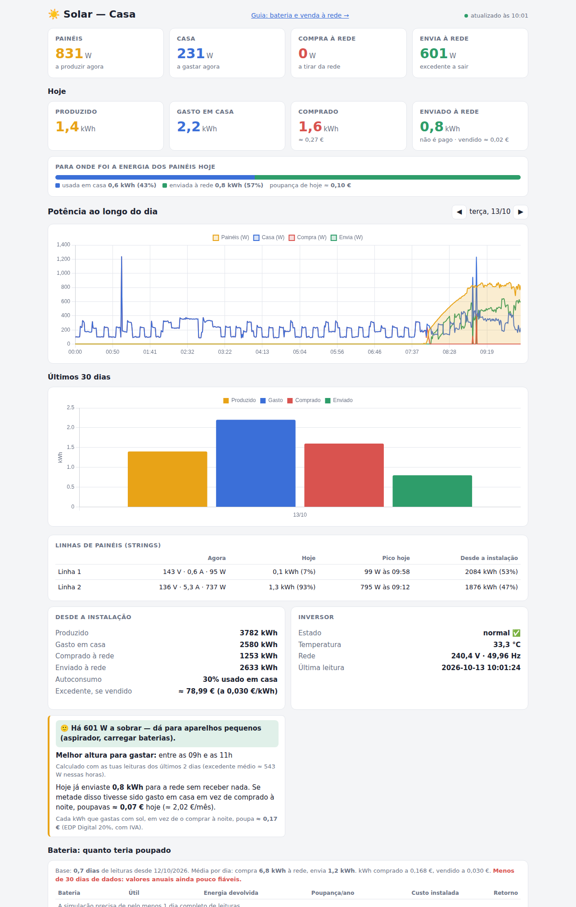
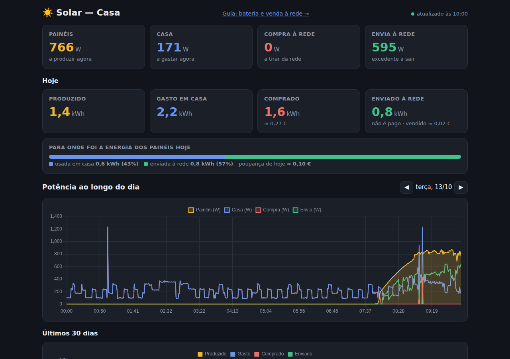
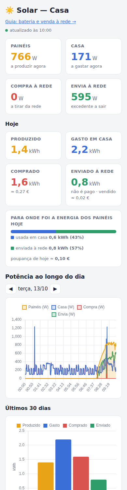
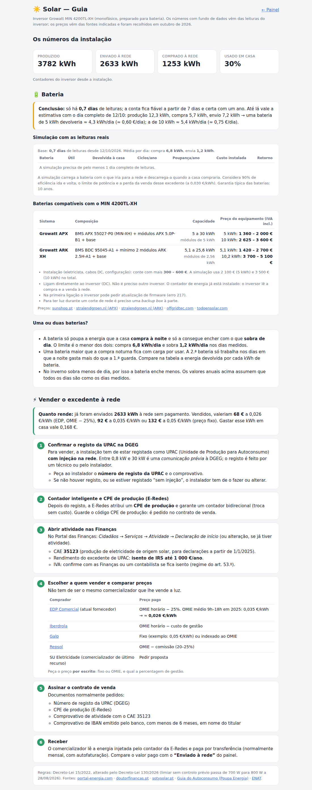

# ☀️ Growatt — painel solar local

Painel web simples para acompanhar um inversor **Growatt MIN 4200TL-XH**. Mostra a produção, o consumo da casa e as trocas com a rede.

O programa lê o inversor diretamente por **Modbus TCP**, através do dongle Wi-Fi, e **apenas lê**: nunca escreve nada no inversor. Não usa a cloud da Growatt e não precisa de dependências externas, só da biblioteca padrão do Python 3. Corre num Raspberry Pi como serviço `systemd` de utilizador.

<p align="center">
  
</p>

<p align="center">
  
  &nbsp;
  
</p>

## O que mostra

- **Agora:** a potência dos painéis, o consumo da casa, quanto se compra à rede e quanto se envia para ela.
- **Hoje:** a energia produzida, gasta, comprada (com o custo em €) e enviada. Inclui um gráfico de para onde foi a energia dos painéis e outro da potência ao longo do dia.
- **Últimos 30 dias:** os totais de cada dia.
- **Linhas de painéis (strings):** para cada linha, a tensão, a corrente e a potência atuais, os kWh de hoje, o pico do dia (W e hora) e os kWh desde a instalação, com a percentagem de cada uma.
- **Desde a instalação:** os contadores totais do inversor.
- **Inversor:** o estado, a temperatura, a tensão e a frequência da rede.
- **Dica:** a janela de horas com mais excedente, calculada a partir das leituras reais dos últimos 7 dias. Serve para saber quando ligar as máquinas.
- **Bateria:** uma simulação, minuto a minuto, de quanto teriam poupado baterias de 5 e 10 kWh, com o retorno em anos.
- **Excedente:** quanto valeria a energia enviada à rede se fosse vendida.

### Guia: bateria e venda à rede (`/guia`)

A página `/guia` reúne:

- a análise de **bateria** com as leituras reais, as baterias compatíveis com o MIN 4200TL-XH (Growatt APX e ARK XH) e os preços, com as fontes;
- o passo a passo para **vender o excedente** em Portugal: registo da UPAC na DGEG, CPE de produção na E-Redes, atividade nas Finanças (CAE 35123), comparação de comercializadores e documentos para o contrato.

<p align="center">
  
</p>

## Como funciona

```
Inversor Growatt ──Modbus TCP :502──▶ solar.py ──▶ solar.db (SQLite)
   (dongle Wi-Fi)    a cada 60 s          │
                                          └──HTTP :8096──▶ index.html (Chart.js)
```

- O `solar.py` lê os *input registers* 3000–3099 (função 04) a cada minuto e guarda cada leitura em `solar.db`. Se uma leitura falhar, tenta mais duas vezes, porque o Wi-Fi do dongle é fraco.
- À noite o inversor desliga-se. Nesse período a página mostra a última leitura guardada.
- A página `index.html` é servida pelo próprio `solar.py` e vai buscar os dados à API.

### API

| Endpoint | Devolve |
|---|---|
| `GET /api/now` | A última leitura, os totais de hoje (incluindo por linha), os picos de cada linha e os preços do kWh |
| `GET /api/today?day=AAAA-MM-DD` | A curva de potência do dia (painéis, casa, compra, envio) |
| `GET /api/days?n=30` | Os totais diários de kWh dos últimos *n* dias (máximo 400) |
| `GET /api/tip` | A melhor janela de horas para gastar o excedente |
| `GET /api/battery?days=30` | A simulação de baterias de 5 e 10 kWh com as leituras reais |

Os totais por dia calculam-se pela diferença dos contadores totais do inversor. Os contadores "hoje" do próprio inversor só voltam a zero quando ele acorda, por isso de madrugada ainda mostrariam o dia anterior.

## Instalação

Guia completo, passo a passo, para instalar numa máquina Linux sempre ligada (um Raspberry Pi, por exemplo) que esteja na mesma rede que o inversor.

### 1. Requisitos

- Linux com `systemd`. Foi testado em Ubuntu no Raspberry Pi.
- Python 3.8 ou mais recente e `git`.
- Um inversor Growatt com **Modbus TCP acessível na rede local** (porta 502), normalmente através do dongle Wi-Fi ou LAN.

Para instalar o Python e o `git` (Debian, Ubuntu ou Raspberry Pi OS):

```bash
sudo apt update
sudo apt install -y python3 git
```

Não há mais nada para instalar: o programa só usa a biblioteca padrão do Python.

### 2. Descobrir o IP do inversor

Procure o dongle na lista de dispositivos do router. Convém **reservar-lhe um IP fixo** no router (pelo MAC do dongle), para o endereço não mudar.

Confirme que a porta Modbus responde. Troque `192.168.1.69` pelo IP do seu dongle:

```bash
nc -zv 192.168.1.69 502
# ou, sem nc:
timeout 3 bash -c '</dev/tcp/192.168.1.69/502' && echo "porta 502 aberta"
```

> O inversor desliga-se à noite. Faça este teste de dia, com sol.

### 3. Descarregar o projeto

O ficheiro do serviço espera o projeto em `~/growatt`, por isso clone-o para essa pasta:

```bash
git clone https://github.com/brumarx/growatt.git ~/growatt
cd ~/growatt
```

### 4. Testar à mão

```bash
SOLAR_INVERTER_IP=192.168.1.69 python3 solar.py
```

Abra `http://<ip-da-máquina>:8096` no browser. Ao fim de cerca de um minuto aparecem os primeiros valores. Para parar, carregue em `Ctrl+C`. O `solar.db` é criado automaticamente na primeira execução.

> Para saber o IP da máquina, use `hostname -I`.

### 5. Configurar

Se o IP do inversor não for `192.168.1.69`, ou se quiser outro preço do kWh, edite o `solar.service` e acrescente linhas `Environment=` na secção `[Service]`. As opções estão descritas em [Configuração](#configuração):

```ini
[Service]
Environment=SOLAR_INVERTER_IP=192.168.1.50
Environment=SOLAR_PRICE_KWH=0.20
```

### 6. Instalar como serviço (arranque automático)

```bash
systemctl --user link ~/growatt/solar.service     # regista o serviço a partir da pasta do projeto
systemctl --user enable --now solar               # ativa no arranque e inicia já
sudo loginctl enable-linger "$USER"               # corre mesmo sem sessão aberta (após reboot)
```

Para confirmar que ficou a funcionar:

```bash
systemctl --user status solar
curl -s http://localhost:8096/api/now
```

### 7. Abrir a página

`http://<ip-da-máquina>:8096`. A página abre em qualquer computador ou telemóvel da rede de casa. No telemóvel, pode usar "Adicionar ao ecrã principal".

### Comandos do dia a dia

```bash
systemctl --user status solar      # estado
systemctl --user restart solar     # reiniciar
systemctl --user stop solar        # parar
journalctl --user -u solar -f      # ver os registos
```

Depois de editar o `solar.service`, corra **dois comandos, um de cada vez**:

```bash
systemctl --user daemon-reload
systemctl --user restart solar
```

### Atualizar para a versão mais recente

```bash
cd ~/growatt
git pull
systemctl --user restart solar
```

O histórico (`solar.db`) mantém-se: o `git` não lhe toca.

### Desinstalar

```bash
systemctl --user disable --now solar
rm -rf ~/growatt        # atenção: apaga também o histórico solar.db
```

### Problemas comuns

| Sintoma | Causa provável / solução |
|---|---|
| A página diz "ainda sem leitura" ou "a reconectar" | O inversor está desligado (é noite) ou o dongle está sem Wi-Fi. Confirme com `nc -zv <ip> 502`. |
| `timed out` / `Connection refused` | O IP está errado ou o dongle não tem Modbus TCP ativo. Confirme o IP no router. |
| A página não abre de outro dispositivo | A firewall está a bloquear a porta 8096. Abra-a com `sudo ufw allow 8096/tcp`. |
| O serviço não arranca depois de um reboot | Falta o `sudo loginctl enable-linger "$USER"`. |
| `Too many arguments` no `systemctl` | Foram colados dois comandos numa só linha. Corra-os um de cada vez. |

## Configuração

Tudo se configura por variáveis de ambiente. Para as definir, acrescente linhas `Environment=` ao `solar.service`.

| Variável | Por omissão | Descrição |
|---|---|---|
| `SOLAR_INVERTER_IP` | `192.168.1.69` | O IP do dongle/inversor |
| `SOLAR_INVERTER_PORT` | `502` | A porta Modbus TCP |
| `SOLAR_POLL_SECONDS` | `60` | O intervalo entre leituras |
| `SOLAR_HTTP_PORT` | `8096` | A porta da página web |
| `SOLAR_PRICE_KWH` | `0.168` | O preço do kWh comprado, em €, com IVA |
| `SOLAR_PRICE_LABEL` | `EDP Digital 20%` | O nome da tarifa que aparece na página |
| `SOLAR_EXPORT_PRICE` | `0.03` | O preço do kWh vendido à rede, em € |
| `SOLAR_BATTERY_COST_5` | `2100` | O custo de uma bateria de 5 kWh já instalada, em € |
| `SOLAR_BATTERY_COST_10` | `3500` | O custo de uma bateria de 10 kWh já instalada, em € |

Exemplo:

```ini
[Service]
Environment=SOLAR_INVERTER_IP=192.168.1.50
Environment=SOLAR_PRICE_KWH=0.20
```

## Ficheiros

| Ficheiro | Descrição |
|---|---|
| `solar.py` | O leitor Modbus, a gravação em SQLite e o servidor HTTP |
| `index.html` | O painel (HTML, CSS e Chart.js) |
| `guia.html` | O guia: bateria e venda do excedente |
| `docs/img/` | As capturas de ecrã do README |
| `solar.service` | A unidade `systemd` de utilizador |
| `solar.db` | O histórico de leituras. É criado automaticamente e **não é publicado** |

## Licença

[MIT](LICENSE)
